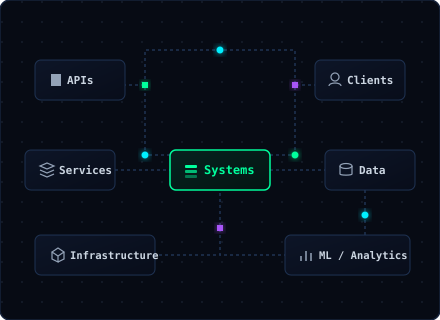

<!-- Terminal Header Navigation -->
<table width="100%">
<tr>
<td align="left"><code><b>kryz73@github:~$</b> █</code></td>
<td align="right"><code>[ <a href="#01-about-me">01 about</a> &nbsp; <a href="#02-quick-stats">02 stats</a> &nbsp; <a href="#03-tech-stack">03 tech</a> &nbsp; <a href="#04-featured-projects">04 projects</a> &nbsp; <a href="#05-github-activity">05 activity</a> &nbsp; <a href="#06-lets-connect">06 contact</a> ]</code> &nbsp; 🔴 🟡 🟢</td>
</tr>
</table>

<!-- Hero Section: Identity & Network Topology -->
<table width="100%">
<tr>
<td width="54%" valign="top">
<code>// developer • learner • builder</code>
<h1>Pulkit Katariya</h1>
<code>@kryz73</code>
  

<b>▌ Building scalable systems at the intersection of software, data, and real-world impact.</b>

<code>&gt; Systems Programming</code> 
<code>&gt; Distributed Systems</code> 
<code>&gt; Machine Learning &amp; Data Science</code> 
<code>&gt; Open Source</code>

 

 

</td>
<td width="46%" align="center" valign="middle">

</td>
</tr>
</table>

<!-- 01. About Me & 02. Quick Stats -->
<table width="100%">
<tr valign="top">
<td width="50%">
<table width="100%">
<tr>
<th align="left" id="01-about-me"><code>01. About Me</code></th>
<th align="right"><code>~/about</code></th>
</tr>
</table>

I'm a B.Tech Mathematics &amp; Computing student at IIITM Gwalior, passionate about systems programming, distributed systems, and scalable backend infrastructure. I enjoy building reliable, high-performance systems and exploring the intersection of software, data, and real-world problems.

</td>
<td width="50%">
<table width="100%">
<tr>
<th align="left" id="02-quick-stats"><code>02. Quick Stats</code></th>
<th align="right"><code>~/stats</code></th>
</tr>
</table>

</td>
</tr>
</table>

<!-- 03. Tech Stack -->
<table width="100%">
<tr>
<th align="left" id="03-tech-stack"><code>03. Tech Stack</code></th>
<th align="right"><code>~/tech</code></th>
</tr>
</table>
<table width="100%">
<thead>
<tr>
<th width="25%" align="left"><code>&lt;/&gt; Languages</code></th>
<th width="27%" align="left"><code>🗄️ Backend &amp; Data</code></th>
<th width="23%" align="left"><code>🖥️ Frontend</code></th>
<th width="25%" align="left"><code>⚙️ Tools &amp; Infra</code></th>
</tr>
</thead>
<tbody>
<tr valign="top">
<td>
 
<code>C++ · Go · Python · TS · C · SQL</code>
</td>
<td>
 
<code>FastAPI · Postgres · Redis · GraphQL</code>
</td>
<td>
 
<code>Next.js · React · Tailwind CSS</code>
</td>
<td>
 
<code>Docker · Linux · Git · K8s · AWS · GCP</code>
</td>
</tr>
</tbody>
</table>

<!-- 04. Featured Projects -->
<table width="100%">
<tr>
<th align="left" id="04-featured-projects"><code>04. Featured Projects</code></th>
<th align="right"><code>~/projects</code></th>
</tr>
</table>
<table width="100%">
<tr valign="top">
<td width="33%">
<table width="100%">
<tr>
<td align="left"><b>📁 ACAD-ERP</b></td>
<td align="right"><code>01</code></td>
</tr>
</table>
<b>Modular Academic ERP Platform</b>
  

A 9-domain modular ERP with role-based access, built using FastAPI, Strawberry GraphQL, and Next.js 14 with a focus on domain-driven architecture.

<code>FastAPI</code> &nbsp; <code>Next.js</code> &nbsp; <code>GraphQL</code> &nbsp; <code>PostgreSQL</code>

 
<a href="https://github.com/kryz73/acad-erp"><b>View Repository ➔</b></a>
</td>
<td width="34%">
<table width="100%">
<tr>
<td align="left"><b>📁 Harvest</b></td>
<td align="right"><code>02</code></td>
</tr>
</table>
<b>24/7 YouTube Ingestion Engine &amp; Parquet Lake</b>
  

A 24/7 Go ingestion daemon deployed on AWS EC2 tracking video trajectories across 3,500+ creators under a strict 10k quota budget with zero-quota RSS discovery.

<code>Go</code> &nbsp; <code>AWS EC2</code> &nbsp; <code>Parquet</code> &nbsp; <code>SQLite</code>

 
<a href="https://github.com/kryz73/harvest"><b>View Repository ➔</b></a>
</td>
<td width="33%">
<table width="100%">
<tr>
<td align="left"><b>📁 URL Shortener</b></td>
<td align="right"><code>03</code></td>
</tr>
</table>
<b>High-Performance Caching Microservice</b>
  

A scalable URL shortener with Redis cache-aside strategy, Base62 encoding, and PostgreSQL pgxpool delivering sub-millisecond p95 redirection.

<code>Go</code> &nbsp; <code>Redis</code> &nbsp; <code>PostgreSQL</code> &nbsp; <code>Docker</code>

 
<a href="https://github.com/kryz73/url-shortner"><b>View Repository ➔</b></a>
</td>
</tr>
</table>

<!-- 05. GitHub Activity & 06. Let's Connect -->
<table width="100%">
<tr valign="top">
<td width="50%">
<table width="100%">
<tr>
<th align="left" id="05-github-activity"><code>05. GitHub Activity</code></th>
<th align="right"><code>~/activity</code></th>
</tr>
</table>

 

</td>
<td width="50%">
<table width="100%">
<tr>
<th align="left" id="06-lets-connect"><code>06. Let's Connect</code></th>
<th align="right"><code>~/contact</code></th>
</tr>
</table>
 
<table width="100%">
<tr>
<td width="28px" align="center">🐙</td>
<td><b>GitHub</b></td>
<td align="right"><a href="https://github.com/kryz73"><code>github.com/kryz73 ➔</code></a></td>
</tr>
<tr>
<td width="28px" align="center">💼</td>
<td><b>LinkedIn</b></td>
<td align="right"><a href="https://www.linkedin.com/in/pulkit-katariya-888a86323/"><code>in/pulkit-katariya ➔</code></a></td>
</tr>
<tr>
<td width="28px" align="center">✉️</td>
<td><b>Email</b></td>
<td align="right"><a href="mailto:pulkit.kr1924@gmail.com"><code>pulkit.kr1924@gmail.com ➔</code></a></td>
</tr>
</table>
</td>
</tr>
</table>
